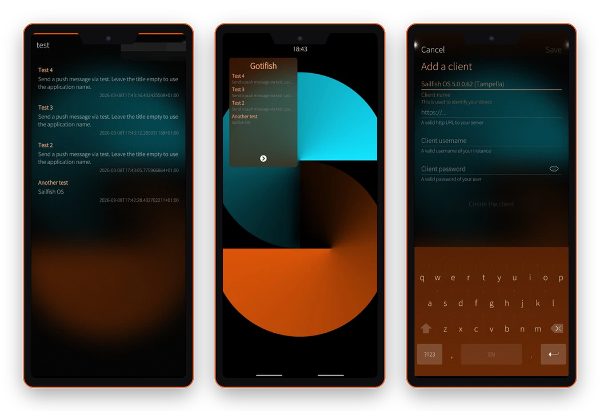
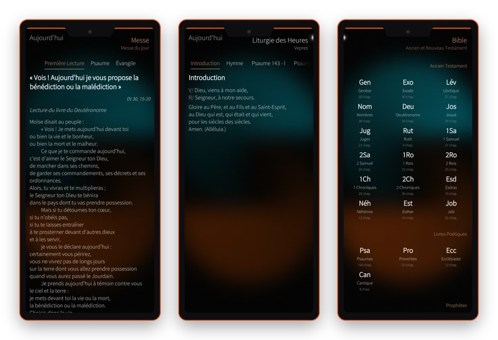
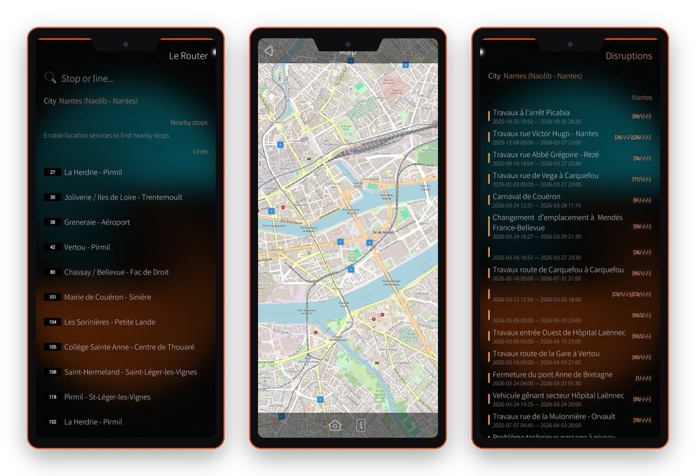

# Erwan

Mobile dev in Brittany, France. Android and iOS at work (Kotlin, Swift, React Native), Sailfish OS apps on the side in Qt/QML and C++.

<!-- assets/jolla-frame.png: put a 1080x2400 screenshot under it at x=54, y=69 -->

###  [Gotifish](https://codeberg.org/erwanlpfr/harbour-gotifish)

Client for [Gotify](https://gotify.net). It keeps a websocket open to your server and shows messages as regular Sailfish notifications.

###  [Lectio](https://codeberg.org/erwanlpfr/harbour-lectio)

Daily readings and the Liturgy of the Hours from AELF, plus a Bible that works offline. In French.

###  [LeRouter](https://codeberg.org/erwanlpfr/harbour-lerouter)

Bus and tram times for French cities, using their open data. Live departures, a map of stops, and disruptions.

### Other stuff

- [harbour-icon-builder](https://codeberg.org/erwanlpfr/harbour-icon-builder), to make Harbour icons in the browser and export every size the store wants.
- [qtcreator-vscode-dx](https://github.com/erwanlpfr/qtcreator-vscode-dx), my Qt Creator config for the Sailfish SDK so it feels like VS Code.

I also do some backend work, mostly Bun/Node and Postgres in Docker. Learning Rust right now.
